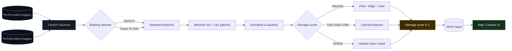
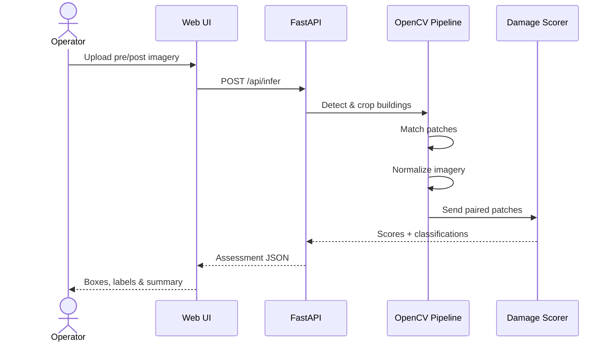

<div align="center">

<!-- Animated banner — rendered dynamically by an external SVG service -->


[](https://www.python.org)
[](https://fastapi.tiangolo.com)
[](https://opencv.org)
[](https://pytorch.org)
[](https://www.docker.com)

**Compare pre-event and post-event imagery · Detect buildings · Quantify potential damage**

[🚀 Quick Start](#-quick-start) · [🎯 Features](#-features) · [🏗️ Architecture](#-architecture) · [📡 API](#-api-reference) · [⚠️ Limitations](#-known-limitations)


</div>

> [!NOTE]
> Sentinel Assess is an end-to-end building damage assessment prototype that can run fully offline. It uses a classical OpenCV detector by default, with optional Faster R-CNN and Twin-Tower CNN paths for stronger models.

## 🌟 Features

<table>
<tr>
<td width="50%">

### 🏘️ Building Detection

- OpenCV Canny + contour detection
- Optional Faster R-CNN pipeline
- Automatic building-boundary extraction
- Real-world coordinate mapping support

</td>
<td width="50%">

### 📊 Damage Analysis

- Pre/post image pair matching
- 161 × 161 patch extraction
- Per-channel histogram equalization
- Normalized 0–1 damage score

</td>
</tr>
<tr>
<td>

### 🧠 Flexible Scoring

- **Heuristic:** lightweight pixel, edge, and color analysis
- **CNN:** Twin-Tower subtract architecture
- Optional NVIDIA hosted vision model

</td>
<td>

### 🗺️ Visual Reporting

- Interactive map and canvas frontend
- Building boxes and damage labels
- JSON assessment results
- Synthetic demo mode

</td>
</tr>
</table>

## 🏗️ Architecture



## 🔄 Analysis Workflow



## 📁 Project Structure

```text
Sentinel-Assess-Building-Damage-Detection-System/
├── backend/
│   ├── main.py          # FastAPI service and API routes
│   ├── detector.py      # OpenCV and Faster R-CNN detectors
│   ├── pipeline.py      # Cropping, normalization, orchestration
│   ├── model.py         # Heuristic + Twin-Tower CNN scoring
│   ├── train.py         # CNN training script
│   └── requirements.txt # Backend dependencies
├── frontend/
│   ├── index.html       # Static web interface
│   └── package.json
├── tests/
│   └── test_pipeline.py # Unit and API tests
└── docker-compose.yml
```

## 🚀 Quick Start

### 🐳 Docker

```bash
docker compose up --build
```

Open `http://localhost:8000` for the API and `http://localhost:5500` for the frontend, depending on your local Compose configuration.

### 🐍 Backend

```bash
cd backend
python -m venv .venv
source .venv/bin/activate       # Windows: .venv\Scripts\activate
pip install -r requirements.txt
uvicorn main:app --reload --port 8000
```

Verify the service:

```bash
curl http://localhost:8000/health
```

### 🌐 Frontend

The frontend is a dependency-free static HTML application:

```bash
cd frontend
python -m http.server 5500
```

Open `http://localhost:5500` and choose **Load a synthetic demo scene** for an instant walkthrough.

> [!TIP]
> Before opening the frontend, set `window.SENTINEL_API_BASE` in `index.html` if the API is hosted on another origin.

## 🧪 Run Tests

```bash
cd backend
pip install pytest
python -m pytest ../tests -q
```

## 📡 API Reference

### `GET /health`

```json
{
  "status": "ok",
  "model_mode": "heuristic"
}
```

### `POST /api/detect`

Accepts a multipart `image` file and returns detected building boxes.

### `POST /api/infer`

Accepts pre-event and post-event images as `pre_image` and `post_image`.

```json
{
  "image_size": [400, 400],
  "model_mode": "heuristic",
  "summary": {
    "total_buildings": 4,
    "damaged": 1,
    "undamaged": 3
  },
  "buildings": [
    {
      "id": "b0",
      "damage_score": 0.83,
      "damaged": true
    }
  ]
}
```

## 🤖 Scoring Modes

| Mode | Requirements | Best for |
|:--|:--|:--|
| `heuristic` | Python + OpenCV | Fast offline demos |
| `cnn` | PyTorch + weights | Labeled building-damage datasets |
| `nvidia` | NVIDIA API credentials | Optional hosted vision inference |

### Enable the CNN

```bash
pip install torch torchvision
export DAMAGE_MODEL=cnn
export MODEL_WEIGHTS=/path/to/tts_model.pt
uvicorn main:app --reload --port 8000
```

### NVIDIA Hosted Vision

```bash
export DAMAGE_MODEL=nvidia
export NVIDIA_API_KEY=nvap-your-key
export NVIDIA_MODEL=meta/llama-3.2-11b-vision-instruct
```

## 🎓 Train the Twin-Tower CNN

```bash
cd backend
pip install torch torchvision
python train.py --data_dir /path/to/data_dir --epochs 20 --out tts_model.pt
```

Expected labeled dataset structure:

```text
data_dir/
├── labels.csv
├── pre/<patch_id>.png
└── post/<patch_id>.png
```

## ⚠️ Known Limitations

- The default contour detector is not a trained building segmentation model.
- The default heuristic is exploratory, not an operational damage classifier.
- Satellite images should be roughly aligned before analysis.
- The current pipeline does not perform geometric registration or orthorectification.
- Train and validate the Twin-Tower CNN with a real disaster dataset before production use.

## 🚢 Deployment Checklist

- [ ] Containerize the complete application
- [ ] Run tests automatically in GitHub Actions
- [ ] Deploy the frontend to a static host
- [ ] Restrict CORS to the frontend domain
- [ ] Store API credentials in a secrets manager
- [ ] Tile large imagery and process tiles concurrently

## 🤝 Contributing

Contributions are welcome. Please open an issue with proposed changes before submitting a pull request.

1. Fork the repository
2. Create a feature branch
3. Add tests for new behavior
4. Open a pull request with screenshots or sample output

## 📜 License

No license is currently included. Add a license before distributing or using this project beyond personal experimentation.

---

<div align="center">

**Built for faster, more accessible post-disaster building assessment**

<a href="https://github.com/Vickygupta333/Sentinel-Assess-Building-Damage-Detection-System/stargazers">⭐ Star this project</a>
·
<a href="https://github.com/Vickygupta333/Sentinel-Assess-Building-Damage-Detection-System/issues">🐛 Report an issue</a>
·
<a href="https://github.com/Vickygupta333/Sentinel-Assess-Building-Damage-Detection-System/fork">🍴 Fork it</a>

</div>
