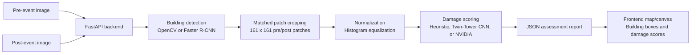
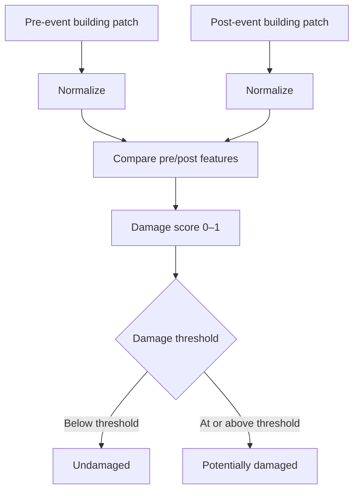

# Sentinel Assess — Building Damage Detection

A working, end-to-end implementation of the pipeline described in
*Xu et al., "Building Damage Detection in Satellite Imagery Using
Convolutional Neural Networks" (NeurIPS 2019)*: upload matched
before/after satellite (or drone/aerial) images of an area, and the system
detects buildings, crops matched pre/post patches, and scores each one for
disaster damage.

It runs **fully offline out of the box** — no pretrained weights, no
internet access, no GPU required — using a classical computer-vision
building detector and a dependency-free heuristic damage scorer. It also
ships the *real* paper-faithful CNN (Twin-Tower Subtract) and a training
script, so you can swap in a trained model once you have labeled data.

## Visual overview



### Per-building analysis



## Project structure

```
project/
├── backend/
│   ├── main.py          FastAPI service (the API)
│   ├── detector.py      Building detection (OpenCV + optional Faster R-CNN)
│   ├── pipeline.py      Patch cropping, normalization, orchestration
│   ├── model.py         Heuristic scorer + real TwinTowerCNN (PyTorch)
│   ├── train.py         Training script for the real CNN
│   └── requirements.txt
├── frontend/
│   └── index.html        Self-contained web UI (no build step)
└── tests/
    └── test_pipeline.py  Unit + API tests (pytest)
```

---

## 1. Quick start (5 minutes)

### Backend

```bash
cd backend
python -m venv .venv && source .venv/bin/activate   # optional but recommended
pip install -r requirements.txt
uvicorn main:app --reload --port 8000
```

Use NVIDIA hosted free-tier vision model instead of local scoring:

```bash
cd backend
set DAMAGE_MODEL=nvidia
set NVIDIA_API_KEY=nvapi-your-key
set NVIDIA_MODEL=meta/llama-3.2-11b-vision-instruct
uvicorn main:app --reload --port 8000
```

You should see `Uvicorn running on http://127.0.0.1:8000`. Check it:

```bash
curl http://localhost:8000/health
# {"status":"ok","model_mode":"heuristic"}
```

### Frontend

The frontend is a single static HTML file — no npm install, no build step.

```bash
cd frontend
python -m http.server 5500
```

Open `http://localhost:5500` in a browser. Click **"Load a synthetic demo
scene"** to try it immediately without any real imagery, or upload your own
matched pre/post images and click **Run assessment**.

> If your backend isn't on `http://localhost:8000`, set
> `window.SENTINEL_API_BASE = "https://your-api-host"` in a small
> `<script>` tag before `index.html`'s closing `</body>`, or edit the
> `API_BASE` constant near the top of the `<script>` block.

### Run the tests

```bash
cd backend
pip install pytest
python -m pytest ../tests -q
```

All 6 tests should pass — they cover patch cropping, histogram
equalization, building detection, the heuristic damage scorer, the full
pipeline, and the `/api/infer` endpoint.

---

## 2. How it works (pipeline)

This mirrors Figure 1 of the paper:

```
pre/post images
      │
      ▼
[1] Building Detection   — find every building-like structure on the pre image
      │
      ▼
[2] Patch Cropping        — crop a matched pre + post patch around each building
      │
      ▼
[3] Normalization          — per-channel histogram equalization on both patches
      │
      ▼
[4] Damage Scoring          — compare pre/post patch → score in [0, 1]
      │
      ▼
Per-building damage report (JSON) → rendered on the map/canvas
```

### Step 1 — Building detection (`backend/detector.py`)

Two implementations are provided:

- **`detect_buildings_cv` (default, active)** — a classical detector using
  Canny edge detection + contour finding + non-max suppression. It needs no
  pretrained weights and no internet access, which is why the whole app
  works offline. It finds real rectangular structures in the image (not a
  static grid), but is far less accurate than a trained detector.
- **`detect_buildings_frcnn` (production path)** — torchvision's pretrained
  Faster R-CNN, exactly as described in the paper and the original project
  plan. Requires `pip install torch torchvision` and internet access (or a
  cached checkpoint) to download COCO weights on first run. In practice
  you'd fine-tune this on a building-footprint dataset (e.g. via
  [xBD](https://xview2.org)) rather than using raw COCO classes, since COCO
  has no "building" class.

To switch, change the `detector=` argument passed to `run_assessment()` in
`backend/main.py`.

### Step 2 — Patch cropping (`backend/pipeline.py::crop_patch`)

For every detected building, a square patch is cropped from both the pre-
and post-event image, centered on the building's centroid. The paper uses
161×161 px at 0.3 m resolution (≈50 m × 50 m on the ground); the code
defaults to the same `PATCH_SIZE = 161`. Patches that fall near the image
edge are reflection-padded rather than dropped, so every detected building
gets a usable crop.

### Step 3 — Normalization (`backend/pipeline.py::histogram_equalize`)

Per-channel histogram equalization, exactly as described in the paper's
data-generation section — this is the *only* preprocessing step, kept
deliberately minimal so it stays practical in a real disaster-response
scenario where heavy manual cleanup isn't feasible.

### Step 4 — Damage scoring (`backend/model.py`)

Two scorers, selected via the `DAMAGE_MODEL` environment variable:

- **`heuristic` (default)** — no ML framework required. Blends three
  classical signals between the pre/post patch: raw pixel difference, edge-
  density change, and color-histogram shift. This is a *stand-in*, not a
  trained model — good enough to make the app run end-to-end, not good
  enough for real damage assessment.
- **`cnn`** — the real **Twin-Tower Subtract (TTS)** architecture from the
  paper (`backend/model.py::build_twin_tower_cnn`). Two weight-shared
  convolutional towers independently encode the pre/post patch, their
  feature maps are subtracted element-wise, and a small head produces a
  sigmoid damage score.

  To use it:
  ```bash
  pip install torch torchvision
  export DAMAGE_MODEL=cnn
  export MODEL_WEIGHTS=/path/to/tts_model.pt
  uvicorn main:app --reload --port 8000
  ```

---

## 3. Training the real CNN on real data

The heuristic scorer is a placeholder. To get results resembling the
paper's, you need labeled data and to train `TwinTowerCNN`.

1. **Get imagery + labels.** Pre/post satellite images and [UNOSAT/HDX](https://data.humdata.org) damage assessments for a real disaster.
2. **Generate patches.** Reuse `backend/pipeline.py`'s `crop_patch` and `histogram_equalize` to create 161×161 pre/post pairs:
   ```
   data_dir/
     labels.csv
     pre/<patch_id>.png
     post/<patch_id>.png
   ```
3. **Train.**
   ```bash
   cd backend
   pip install torch torchvision
   python train.py --data_dir /path/to/data_dir --epochs 20 --out tts_model.pt
   ```
4. **Serve it.** Set `DAMAGE_MODEL=cnn` and `MODEL_WEIGHTS=tts_model.pt`.

---

## 4. API reference

### `GET /health`
```json
{ "status": "ok", "model_mode": "heuristic" }
```

### `POST /api/detect`
Multipart form field: `image` (single file). Returns detected building boxes.

### `POST /api/infer`
Multipart form fields: `pre_image`, `post_image`. Runs the full pipeline.

```json
{
  "image_size": [400, 400],
  "model_mode": "heuristic",
  "summary": { "total_buildings": 4, "damaged": 1, "undamaged": 3 },
  "buildings": [{ "id": "b0", "damage_score": 0.83, "damaged": true }]
}
```

---

## 5. Deploying beyond localhost

- **Containerize:** wrap `backend/` in a Python 3.11-slim Docker image and run Uvicorn on port 8000.
- **CI:** add a GitHub Actions workflow that runs `pytest ../tests` on every push.
- **Serve the frontend statically:** host `frontend/index.html` on S3, CloudFront, GitHub Pages, Netlify, or another static host.
- **Security:** use HTTPS, authenticate the API, restrict CORS to the frontend domain, and store provider credentials in a secrets manager.
- **Scale:** tile large imagery and process tiles across multiple workers, then merge the per-tile building lists.

---

## 6. Known limitations (read before using on real imagery)

- The default building detector is a classical contour detector, not a trained model. It can miss irregular or densely packed buildings and detect non-building rectangles.
- The default damage scorer is a pixel/edge/color heuristic, not a trained classifier. Train and serve `TwinTowerCNN` before operational use.
- Pre/post images must already be roughly aligned. The pipeline resizes the post image but does not perform geometric registration.
